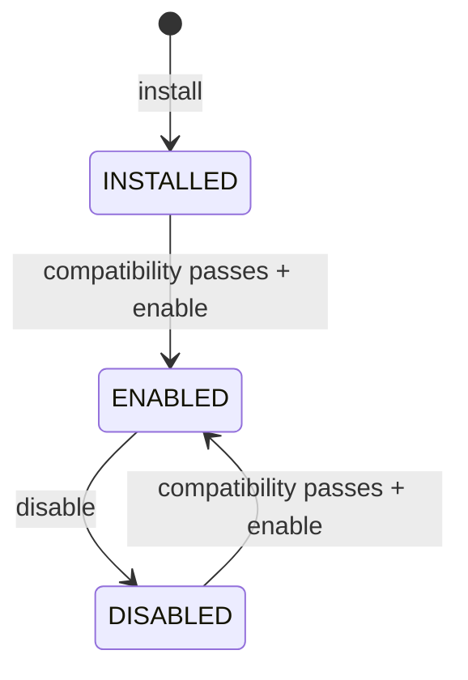

# Module Registration & Activation

## Initial bundled module

The first registered module is Commerce:

- ID: `commerce` (stable identifier; do not derive it from the display name)
- Version: `0.1.0`
- Source: `bundled`
- Platform compatibility: `>=0.1.0 <1.0.0`
- Required tenant migration: `202611030001_tenant_commerce`
- Workspace permission: `modules.manage`

The manifest is declared in `apps/api/src/core/modules/module-manifest.ts` and registered through `ModuleRegistryService`. It declares module identity, version, source, compatibility, dependencies, required tenant migrations, and permission keys.

## Lifecycle

A module installation is scoped to one Workspace. Installation does not run tenant SQL; it verifies the required migration ledger and records the bundled module installation in the Control DB. Enabling re-runs compatibility checks. Disabling does not remove tenant data or migration history.

A different installed version is rejected until a versioned upgrade lifecycle is implemented. No automatic downgrade or uninstall is performed. Install is idempotent for an existing matching module version.

## Compatibility checks

Before install/enable, the service checks:

1. Platform semantic version is within the manifest range.
2. All manifest permission keys exist in the Control DB permission catalog.
3. Every declared module dependency is enabled for the Workspace.
4. Every required tenant migration is present in that Workspace's `tenant_migrations` ledger.

A failed check blocks the lifecycle transition and returns the reasons. It does not change the installation record.

## API

All routes require an authenticated session and `modules.manage` for the target active Workspace.

- `GET /workspaces/:workspaceId/modules` — registered manifests, installation state, compatibility
- `GET /workspaces/:workspaceId/modules/audit` — latest 100 module lifecycle audit events
- `GET /workspaces/:workspaceId/modules/:moduleId/compatibility` — compatibility report
- `POST /workspaces/:workspaceId/modules/:moduleId/install` — register installation
- `POST /workspaces/:workspaceId/modules/:moduleId/enable` — enable after compatibility check
- `POST /workspaces/:workspaceId/modules/:moduleId/disable` — disable without data deletion

Workspace UI: `/workspace/:slug/modules`. The screen displays the manifest, compatibility result, installation status, lifecycle actions, and audit history. Lifecycle changes require browser confirmation.

## Audit

Install, enable, and disable are committed with their corresponding Control DB audit event in one transaction. Events use `MODULE_INSTALLED`, `MODULE_ENABLED`, and `MODULE_DISABLED`, scoped by Workspace and actor.

The runtime role inherits SELECT/INSERT access to `platform_audit_logs` from its existing SELECT/INSERT/UPDATE access on `module_installations`, through the forward-only grant migration.

## Migration and rollout safety

- `202611060003_module_registration_activation` extends the existing `module_installations` table and creates `platform_audit_logs`.
- `202611060004_module_audit_runtime_grants` grants the existing Control DB application roles access to the audit table without broadening privileges for roles that cannot manage module installations.

Both migrations have been applied to the local Control DB after a custom-format backup was restored to an isolated rehearsal database and the migration/backfill behavior was verified. The backup is stored under `D:\Back up\SyncUp`.

Do not insert a module installation row manually. Do not activate Commerce in `pos-local` until compatibility passes for that Workspace and a separate activation approval is given. The E2E lifecycle test is isolated to `e2e-commerce-20261106` and intentionally leaves Commerce in DISABLED state. It does not create or change Store/Branch/Warehouse business records.
